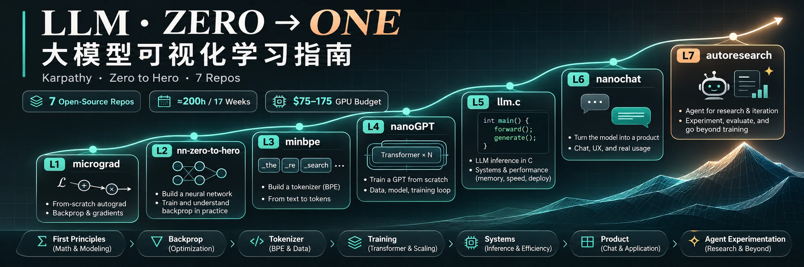

<div align="center">

<a href="https://meetrust.github.io/llm-visual-guide/"></a>

# 大模型可视化学习指南

**LLM Zero to One · A Visual Learning Guide**

从 100 行的反向传播引擎出发，一路走到能通宵替你做实验的 Agent。
<br>
*From a 100-line backprop engine all the way to an agent that runs your training experiments overnight.*

[](https://meetrust.github.io/llm-visual-guide/) [](https://github.com/meetrust/llm-visual-guide/actions/workflows/deploy-pages.yml)

[在线访问 Live](https://meetrust.github.io/llm-visual-guide/) · [概览 Overview](#概览--overview) · [页面内容 Contents](#页面内容--contents) · [项目结构 Structure](#项目结构--structure) · [本地预览 Run locally](#本地预览--run-locally)

</div>

## 概览 · Overview

以 Andrej Karpathy 的七个开源仓库为主线，把“从零构建大模型”整理成一份可视化学习手册。

七个仓库对应七级抽象阶梯：micrograd、nn-zero-to-hero、minbpe、nanoGPT、llm.c、nanochat、autoresearch。每上一级，你都会亲手造出一个能运行的东西。页面把它们的依赖关系、核心机制、工程亮点、投入成本和学习路线放在同一张“地图”上，适合想系统补齐大模型底层能力的工程师。

A visual study guide to building large language models from scratch, following Andrej Karpathy's seven open-source repositories.

The seven repositories form a seven-step abstraction ladder: micrograd, nn-zero-to-hero, minbpe, nanoGPT, llm.c, nanochat and autoresearch. At every step you build something that actually runs. The page puts their dependencies, core mechanisms, engineering highlights, costs and learning roadmap on a single map, for engineers who want a solid grasp of how LLMs work under the hood.

| **7** | **307.8k** | **≈200 h** | **$75–175** |
|:---:|:---:|:---:|:---:|
| 个开源仓库<br><sub>open-source repos</sub> | GitHub Star 合计<br><sub>GitHub stars in total</sub> | 标准路线 · 17 周<br><sub>standard route · 17 weeks</sub> | 全程 GPU 预算<br><sub>total GPU budget</sub> |

## 页面内容 · Contents

| 章节 Section | 内容 What's inside | 主要图表 Key figures |
|---|---|---|
| 00 一页速览<br><sub>At a glance</sub> | 七级抽象阶梯、关键数字、素材中需要校准的 4 处事实<br><sub>The seven-level ladder, key numbers and 4 commonly misquoted facts</sub> | — |
| 01 技能雷达与图谱架构<br><sub>Skill radar & dependency map</sub> | 七个项目的依赖关系、前置知识与心智门槛<br><sub>How the seven projects depend on each other, prerequisites and mental hurdles</sub> | FIG.01 项目依赖图谱 · FIG.02 四个关键阶段<br><sub>FIG.01 Project dependencies · FIG.02 Four key stages</sub> |
| 02 核心模块拆解<br><sub>Module deep dives</sub> | 每个仓库的核心机制、工程亮点与关键产出<br><sub>Core mechanism, engineering highlights and key outputs of each repo</sub> | FIG.03 speedrun 流水线 · FIG.04 实验循环<br><sub>FIG.03 Speedrun pipeline · FIG.04 Experiment loop</sub> |
| 03 多维对比表<br><sub>Comparison table</sub> | 代码量、语言、硬件、抽象层级、成本、门槛、耗时<br><sub>Code size, language, hardware, abstraction level, cost, difficulty and time</sub> | — |
| 04 可视化看板<br><sub>Dashboard</sub> | Star 对比、成本断崖、耗时与难度热力表<br><sub>Star counts, the cost cliff, and a time and difficulty heatmap</sub> | FIG.05 Star 数 · FIG.06 成本曲线 · FIG.07 耗时 × 难度象限 · FIG.08 时间投入分布<br><sub>FIG.05 Stars · FIG.06 Cost curve · FIG.07 Time × difficulty · FIG.08 Time allocation</sub> |
| 05 学习路线与时间表<br><sub>Roadmap & schedule</sub> | 17 周标准路线、阶段验收标准、快速通道、预算与避坑<br><sub>A 17-week standard route, exit criteria per stage, a fast track, budget and pitfalls</sub> | FIG.09 17 周标准路线<br><sub>FIG.09 17-week standard route</sub> |
| 06 方向建议<br><sub>Career directions</sub> | 结合 Agent、系统与机器人方向的进阶建议<br><sub>Next steps toward agents, systems and robotics</sub> | — |
| 07 来源<br><sub>Sources</sub> | 全部数据与引用的出处<br><sub>Where every number and quote comes from</sub> | — |

## 项目结构 · Structure

```
index.html            页面本体 · the page itself
docs/handbook.md      Markdown 版手册 · the handbook in Markdown
docs/images/          README 首屏大图 · README banner
tools/audit.js        页面检查脚本 · page check script
.github/workflows/    推送到 main 后自动发布 · publishes to GitHub Pages on push to main
```

## 本地预览 · Run locally

页面没有构建步骤，直接打开 `index.html` 即可；也可以起一个本地服务：

There is no build step: open `index.html` directly, or serve the folder locally:

```bash
python3 -m http.server 8000
# 打开 / open http://localhost:8000/
```

## 数据说明 · Data notes

- 数据核对于 2026-11-02；Star 数取自各仓库的 GitHub 页面。<br><sub>Data checked on 2026-11-02; star counts come from each repository's GitHub page.</sub>
- 耗时、难度与预算为经验估计，云 GPU 成本按约 $3 / GPU·小时计算。<br><sub>Time, difficulty and budget are experience-based estimates; cloud GPU cost assumes about $3 per GPU-hour.</sub>
- 页面内全部引用见第 07 节“来源”。<br><sub>All references are listed in section 07, Sources.</sub>

## 同系列 · Companion project

[《斯坦福 AI 课程地图》](https://github.com/meetrust/stanford-ai-courses)：10 门斯坦福 AI 核心课程的依赖图谱、课程档案、对比矩阵与学习路线。[在线访问](https://meetrust.github.io/stanford-ai-courses/)

[Stanford AI Course Map](https://github.com/meetrust/stanford-ai-courses): a dependency graph, course dossiers, a comparison matrix and learning paths for 10 core Stanford AI courses. [Live site](https://meetrust.github.io/stanford-ai-courses/)
