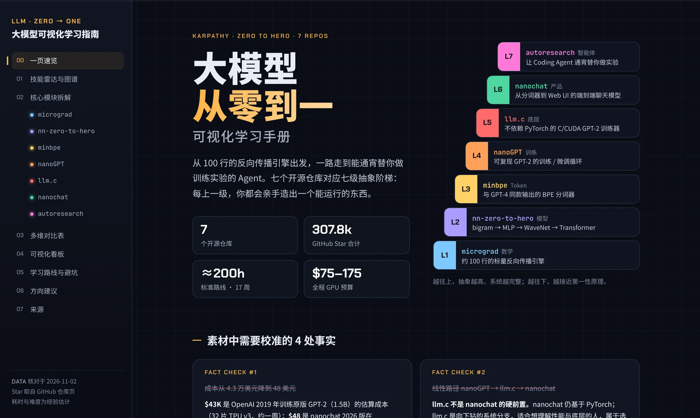
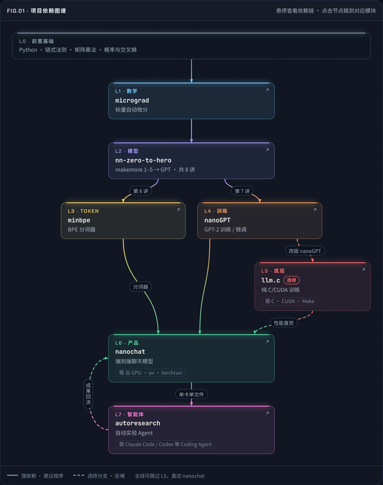
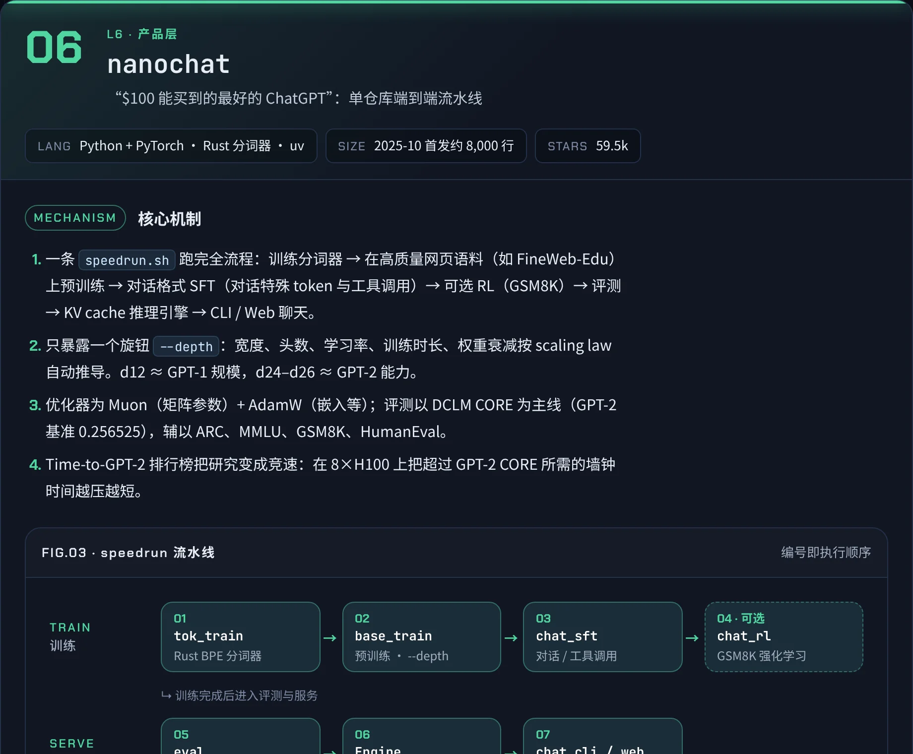
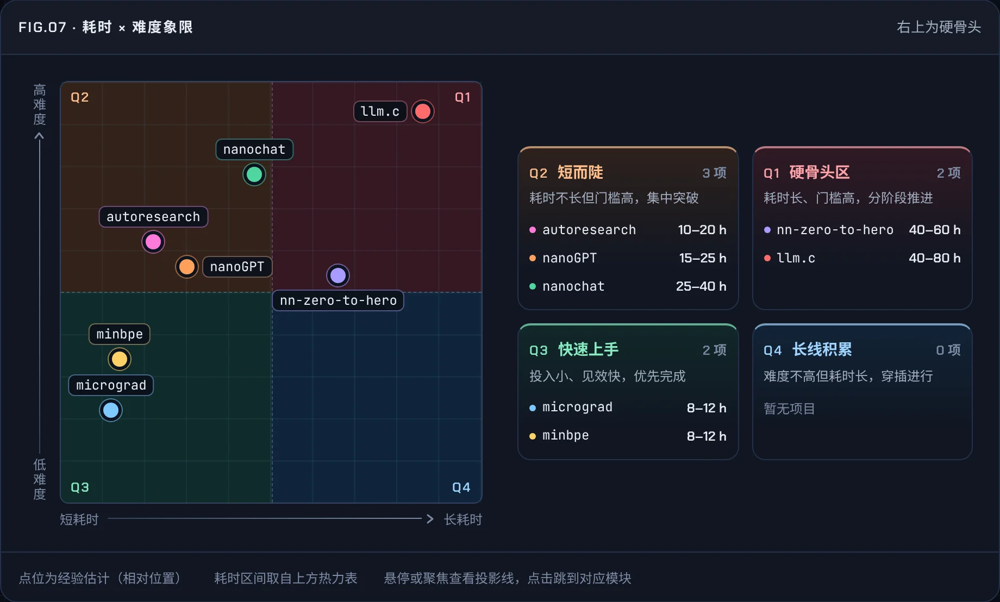
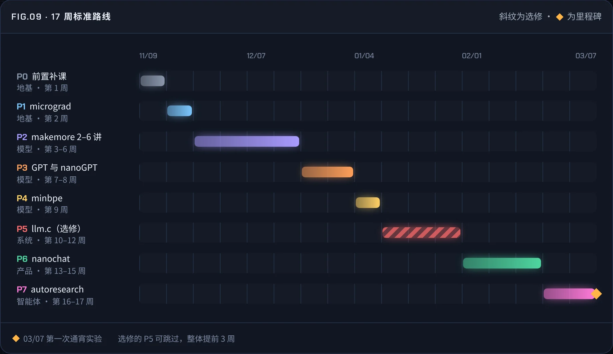
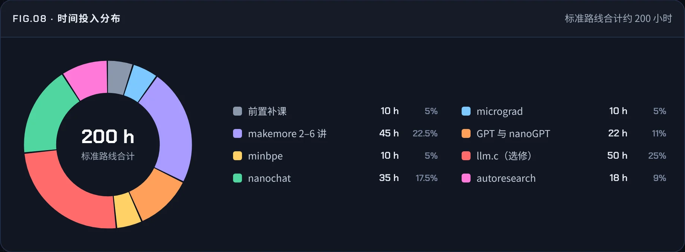
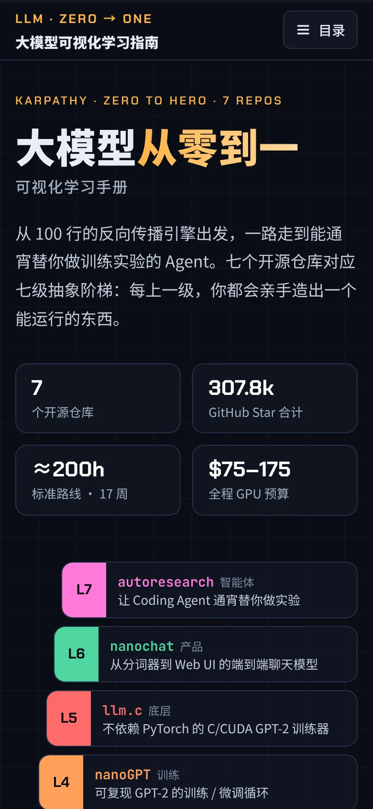

<div align="center">

<a href="https://meetrust.github.io/llm-visual-guide/"></a>

# 大模型可视化学习指南

**从 100 行的反向传播引擎出发，一路走到能通宵替你做实验的 Agent。**

以 Andrej Karpathy 的七个开源仓库为主线，把“从零构建大模型”整理成一份可视化学习手册。

[](https://meetrust.github.io/llm-visual-guide/) [](https://github.com/meetrust/llm-visual-guide/actions/workflows/deploy-pages.yml)   

[在线访问](https://meetrust.github.io/llm-visual-guide/) · [概览](#概览) · [页面内容](#页面内容) · [页面预览](#页面预览) · [设计语言](#设计语言) · [技术实现](#技术实现) · [本地预览](#本地预览)

</div>

## 概览

七个仓库对应七级抽象阶梯：micrograd、nn-zero-to-hero、minbpe、nanoGPT、llm.c、nanochat、autoresearch。每上一级，你都会亲手造出一个能运行的东西。页面把它们的依赖关系、核心机制、工程亮点、投入成本和学习路线放在同一张“地图”上，适合想系统补齐大模型底层能力的工程师。

| **7** | **307.8k** | **≈200 h** | **$75–175** |
|:---:|:---:|:---:|:---:|
| 个开源仓库 | GitHub Star 合计 | 标准路线 · 17 周 | 全程 GPU 预算 |

## 页面内容

| 章节 | 内容 | 主要图表 |
|---|---|---|
| 00 一页速览 | 七级抽象阶梯、关键数字、素材中需要校准的 4 处事实 | — |
| 01 技能雷达与图谱架构 | 七个项目的依赖关系、前置知识与心智门槛 | FIG.01 项目依赖图谱 · FIG.02 四个关键阶段 |
| 02 核心模块拆解 | 每个仓库的核心机制、工程亮点与关键产出 | FIG.03 speedrun 流水线 · FIG.04 实验循环 |
| 03 多维对比表 | 代码量、语言、硬件、抽象层级、成本、门槛、耗时 | — |
| 04 可视化看板 | Star 对比、成本断崖、耗时与难度热力表 | FIG.05 Star 数 · FIG.06 成本曲线 · FIG.07 耗时 × 难度象限 · FIG.08 时间投入分布 |
| 05 学习路线与时间表 | 17 周标准路线、阶段验收标准、快速通道、预算与避坑 | FIG.09 17 周标准路线 |
| 06 方向建议 | 结合 Agent、系统与机器人方向的进阶建议 | — |
| 07 来源 | 全部数据与引用的出处 | — |

## 页面预览

<table>
<tr>
<td width="50%" valign="top"><br><sub>FIG.01 · 项目依赖图谱</sub></td>
<td width="50%" valign="top"><br><sub>核心模块卡片 · nanochat</sub></td>
</tr>
<tr>
<td width="50%" valign="top"><br><sub>FIG.07 · 耗时 × 难度象限</sub></td>
<td width="50%" valign="top"><br><sub>FIG.09 · 17 周标准路线</sub></td>
</tr>
<tr>
<td width="50%" valign="top"><br><sub>FIG.08 · 时间投入分布</sub></td>
<td width="50%" valign="top"><br><sub>手机版首屏</sub></td>
</tr>
</table>

## 设计语言

页面遵循 **Tight Surface** 设计规范，与[《斯坦福 AI 课程地图》](https://meetrust.github.io/stanford-ai-courses/)属于同一设计系列：同一套配色、字体、组件和交互规则，版式各不相同。

**界面配色**　     

**数据配色**（L1 数学 → L7 智能体）　      

| 原则 | 在本页的体现 |
|---|---|
| 信息优先 | 每种颜色对应一个抽象层级；首屏数字与明细逐项一致，页脚写明数据核对日期 |
| 紧凑与平静 | 4px 间距体系、统一的胶囊与按钮尺寸；界面强调色只有琥珀色 |
| 具触感 | 卡片悬停上浮，图表悬停高亮依赖链；悬停效果只在鼠标设备上出现 |
| 可访问性 | 文字对比度 ≥ 4.5:1，琥珀色焦点环，减少动态效果时关闭全部动画 |
| 原生实现 | 九张图全部由 HTML/CSS 与内联 SVG 绘制，图内文字在任何宽度下都不小于 12px |

字体：Chakra Petch 用于编号和数字，Noto Sans SC 用于中文正文，JetBrains Mono 用于仓库名与代码。

## 技术实现

| 项目 | 说明 |
|---|---|
| 页面 | 单个 `index.html`，HTML + CSS + 原生 JavaScript，无构建、无框架 |
| 图表 | 依赖图谱、雷达、条形、成本曲线、象限、环形图、甘特路线均为原生实现，不依赖图表库 |
| 交互 | 左侧目录随滚动高亮；图表支持鼠标悬停、键盘聚焦与触屏轻点 |
| 响应式 | 桌面左侧目录，1024px 以下收为抽屉，760px 以下单栏 |
| 外部依赖 | 仅 Google Fonts；字体加载失败时退回系统字体，内容不受影响 |

## 项目结构

```
index.html                 页面本体
docs/handbook.md           同内容的 Markdown 版手册
docs/images/               README 中的页面截图
tools/audit.js             页面检查脚本
.github/workflows/         推送到 main 后自动发布到 GitHub Pages
```

## 本地预览

页面没有构建步骤，直接打开 `index.html` 即可；也可以起一个本地服务：

```bash
python3 -m http.server 8000
# 打开 http://localhost:8000/
```

## 数据说明

- 数据核对于 2026-11-02；Star 数取自各仓库的 GitHub 页面。
- 耗时、难度与预算为经验估计，云 GPU 成本按约 $3 / GPU·小时计算。
- 页面内全部引用见第 07 节“来源”。

## 同系列

《斯坦福 AI 课程地图》：10 门斯坦福 AI 核心课程的依赖图谱、课程档案、对比矩阵与学习路线。[在线访问](https://meetrust.github.io/stanford-ai-courses/) · [仓库](https://github.com/meetrust/stanford-ai-courses)
