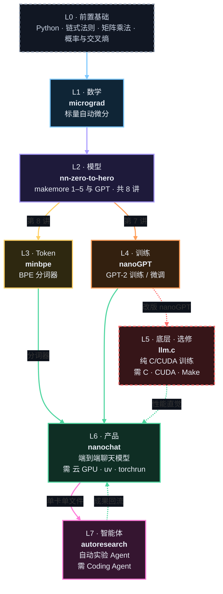
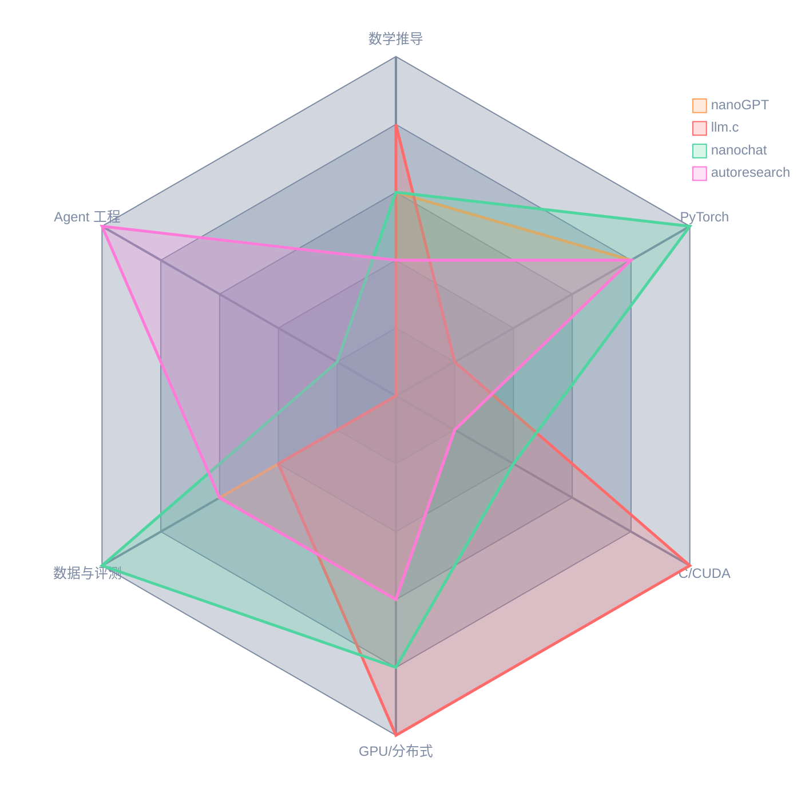
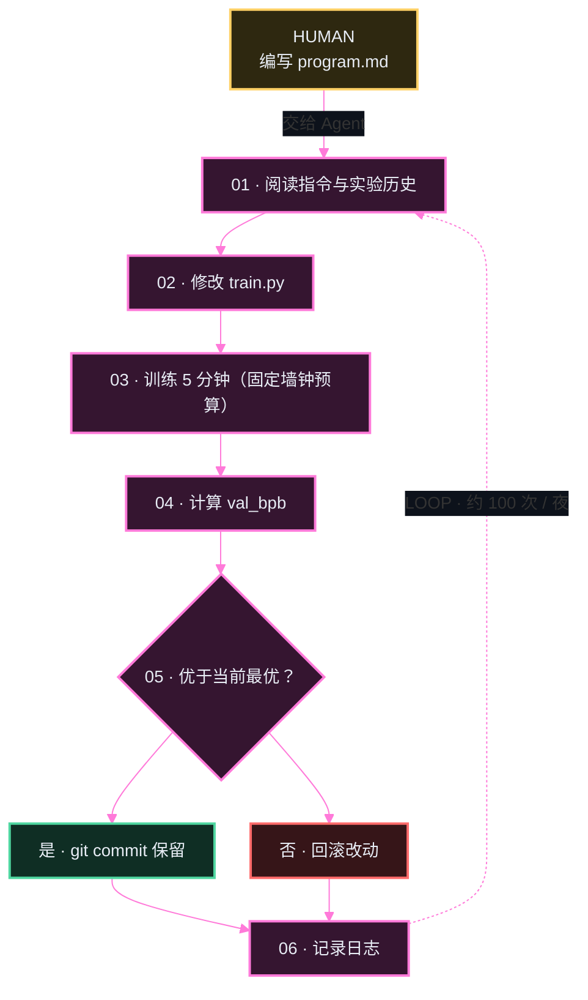
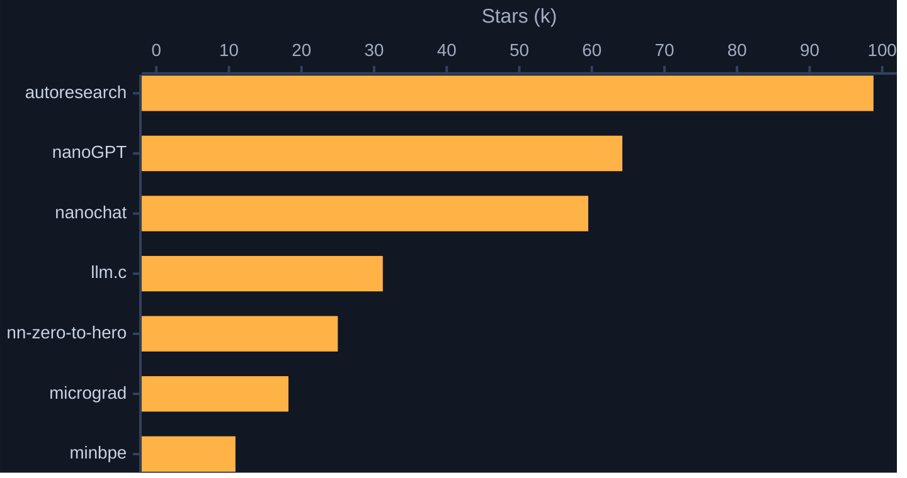
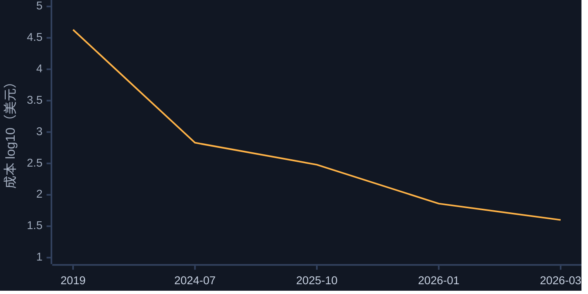
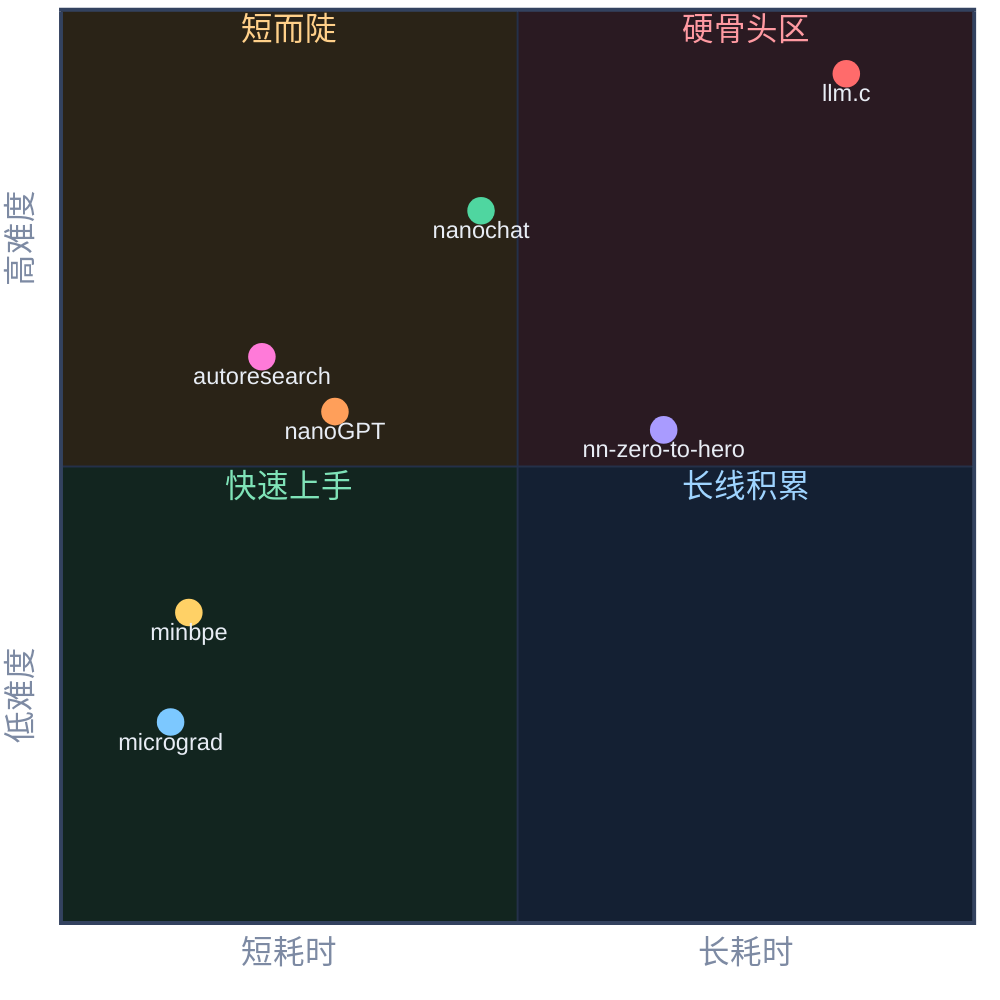
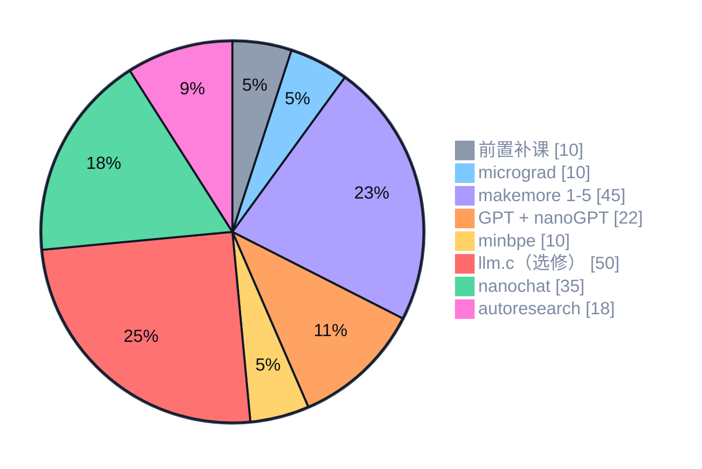
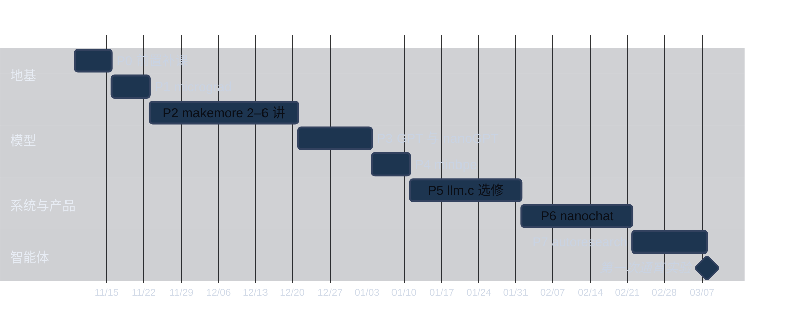

<!--
设计规范（与 HTML 版《大模型可视化学习指南》保持一致）
· 层级配色 L0–L7：#8b97ab #7cc8ff #a99bff #ffd166 #ff9f5a #ff6b6b #4fd6a0 #ff7ad9；琥珀色 #ffb347 是唯一的强调色
· 图表底色 #111723，节点底色为对应层级色的深色调，正文浅色 #e8edf5，次要文字 #7d8aa3（浅色、深色阅读器都可读）
· 标签芯片一律用行内代码：`MECHANISM` `HIGHLIGHTS` `OUTPUT` `FACT CHECK #n` `L1 · 数学` 等
· 图表编号 FIG.01–09 与 HTML 版一一对应；ASCII 图只用纯 ASCII 字符，避免中文字体下 → ① × ─ 等符号变成双倍宽度而错位
· Mermaid themeVariables 的取值不能含连字符（会被安全过滤整项丢弃），所以字体栈不写 sans-serif
-->

`KARPATHY · ZERO TO HERO · 7 REPOS`

# 大模型从零到一 · 可视化学习手册

从 100 行的反向传播引擎出发，一路走到能通宵替你做训练实验的 Agent。七个开源仓库对应七级抽象阶梯：每上一级，你都会亲手造出一个能运行的东西。

| **7** | **307.8k** | **≈200 h** | **$75–175** |
|:---:|:---:|:---:|:---:|
| 个开源仓库 | GitHub Star 合计 | 标准路线 · 17 周 | 全程 GPU 预算 |

`DATA` 核对于 2026-11-02　·　Star 取自 GitHub 仓库页　·　耗时与难度为经验估计

---

## 目录

- [00 一页速览](#00-一页速览)
- [01 技能雷达与图谱架构](#01-技能雷达与图谱架构)
- [02 核心模块拆解](#02-核心模块拆解)
  - [2.1 micrograd](#21-micrograd)　·　[2.2 nn-zero-to-hero](#22-nn-zero-to-hero)　·　[2.3 minbpe](#23-minbpe)　·　[2.4 nanoGPT](#24-nanogpt)
  - [2.5 llm.c](#25-llmc)　·　[2.6 nanochat](#26-nanochat)　·　[2.7 autoresearch](#27-autoresearch)
- [03 多维对比表](#03-多维对比表)
- [04 可视化看板](#04-可视化看板)
- [05 学习路线与时间表](#05-学习路线与时间表)
- [06 结合 Agent / 系统 / 机器人方向的建议](#06-结合-agent--系统--机器人方向的建议)
- [来源](#来源)

## 图例

全文所有图表共用一套层级配色；表格中的 `L1`–`L7` 标签对应同一层级。

| 层级 | 抽象 | 项目 | 色值 |
|---|---|---|---|
| `L0` | 前置基础 | — | `#8b97ab` 灰 |
| `L1` | 数学 | micrograd | `#7cc8ff` 冰蓝 |
| `L2` | 模型 | nn-zero-to-hero | `#a99bff` 紫 |
| `L3` | Token | minbpe | `#ffd166` 黄 |
| `L4` | 训练 | nanoGPT | `#ff9f5a` 橙 |
| `L5` | 底层（选修） | llm.c | `#ff6b6b` 红 |
| `L6` | 产品 | nanochat | `#4fd6a0` 绿 |
| `L7` | 智能体 | autoresearch | `#ff7ad9` 粉 |

`实线` 强依赖，建议按顺序学　`虚线` 选修分支或反哺　`琥珀色` 全文唯一的强调色　难度星级：★ 越多越难

---

## 00 一页速览

`OVERVIEW` 先看清七级阶梯，再修正素材里的四个常见误解。

### 0.1 抽象阶梯

越往上，抽象越高、系统越完整；越往下，越接近第一性原理。

| 层级 | 高度 | 项目 | 抽象 | 你亲手造出的东西 |
|---|---|---|---|---|
| `L7` | ▰▰▰▰▰▰▰ | **autoresearch** | 智能体 | 让 Coding Agent 通宵替你做训练实验 |
| `L6` | ▰▰▰▰▰▰ | **nanochat** | 产品 | 从分词器到 Web UI 的端到端聊天模型 |
| `L5` | ▰▰▰▰▰ | **llm.c** | 底层 | 不依赖 PyTorch 的 C/CUDA GPT-2 训练器 |
| `L4` | ▰▰▰▰ | **nanoGPT** | 训练 | 可复现 GPT-2 的训练 / 微调循环 |
| `L3` | ▰▰▰ | **minbpe** | Token | 与 GPT-4 同款输出的 BPE 分词器 |
| `L2` | ▰▰ | **nn-zero-to-hero** | 模型 | bigram、MLP、WaveNet 一路到 Transformer |
| `L1` | ▰ | **micrograd** | 数学 | 约 100 行的标量反向传播引擎 |

### 0.2 素材中需要校准的 4 处事实

> `FACT CHECK #1`　~~成本从 4.3 万美元降到 48 美元~~
>
> **$43K** 是 OpenAI 2019 年训练原版 GPT-2（1.5B）的估算成本（32 片 TPU v3，约一周）；**$48** 是 nanochat 2026 版在 8×H100 上约 2 小时达到 GPT-2 CORE 分数的按需价（spot 约 $15）。2025-10 首发的"$100 / 4 小时"档模型尚未达到 GPT-2 水平。

> `FACT CHECK #2`　~~线性路径 nanoGPT → llm.c → nanochat~~
>
> **llm.c 不是 nanochat 的硬前置。** nanochat 仍基于 PyTorch；llm.c 是向下钻的系统分支，适合想理解性能与底层的人，属于选修。

> `FACT CHECK #3`　~~nanoGPT 是训练 GPT 的首选~~
>
> nanoGPT README 自 **2025-11** 起已标注过时，作者建议改用 nanochat。它仍是最好读的教材，但不再是实践首选。

> `FACT CHECK #4`　~~前三个项目是三个独立阶段~~
>
> micrograd 是课程**第 1 讲**，nanoGPT 对应**第 7 讲**，minbpe 对应**第 8 讲**：它们是"视频课 + 配套仓库"交织的关系。

---

## 01 技能雷达与图谱架构

`SKILL GRAPH` 从上到下是推荐的学习顺序；颜色对应抽象层级。

### 1.1 项目依赖图谱

**FIG.01 · 项目依赖图谱**　连线颜色取目标节点的层级色



`实线` 强依赖，建议按序　`虚线` 选修分支或反哺　主线可跳过 L5，直达 nanochat

### 1.2 前置知识与心智门槛

| 层级 | 项目 | 硬前置（必须） | 软前置（有更好） | 最难跨过的那道坎 | 门槛 |
|---|---|---|---|---|---|
| `L1` | **micrograd** | Python 类与运算符重载；导数、链式法则 | 递归、拓扑排序 | 理解"梯度 = 局部导数 × 上游梯度"，且必须**累加**而非覆盖 | ★☆☆☆☆ |
| `L2` | **nn-zero-to-hero** | micrograd；张量与广播思维 | 概率、最大似然估计 | 第 5 讲不调用 `.backward()`，手推交叉熵与 BatchNorm 的梯度 | ★★★☆☆ |
| `L3` | **minbpe** | Python 字符串与 `bytes`；UTF-8 | 正则表达式 | "字节 ≠ 字符"；编码时按 merge **先后顺序**而非当前频次合并 | ★★☆☆☆ |
| `L4` | **nanoGPT** | Transformer 结构；`nn.Module` | DDP、混合精度 | 从"能跑"到"能复现"：学习率调度、梯度累积、读懂 loss 曲线 | ★★★☆☆ |
| `L5` | **llm.c** | C 指针与内存布局；每层前向 / 反向公式 | CUDA 线程模型、cuBLAS | 没有 autograd：每个算子的反向都要自己写对，并逐层与 PyTorch 对齐 | ★★★★★ |
| `L6` | **nanochat** | nanoGPT 全部内容 + 分词 | 分布式训练、评测基准、云 GPU 运维 | 全流程系统观：预训练、对话微调、RL、评测、推理服务，并接受"算力即预算" | ★★★★☆ |
| `L7` | **autoresearch** | nanochat 训练核心；git | Coding Agent 经验、实验设计 | 从"写代码"转向"写研究指令"（`program.md`），并分辨改进是信号还是噪声 | ★★★☆☆ |

### 1.3 技能雷达

**FIG.02 · 四个关键阶段**　0–5 分，经验评估；雷达图需 Mermaid 11.6 及以上，不渲染时看下方表格



| 层级 | 项目 | 数学 | PyTorch | C/CUDA | GPU | 数据评测 | Agent |
|---|---|---|---|---|---|---|---|
| `L1` | micrograd | ▰▰▰▱▱ | ▰▰▱▱▱ | ▱▱▱▱▱ | ▱▱▱▱▱ | ▰▱▱▱▱ | ▱▱▱▱▱ |
| `L2` | nn-zero-to-hero | ▰▰▰▰▱ | ▰▰▰▰▱ | ▱▱▱▱▱ | ▰▱▱▱▱ | ▰▰▱▱▱ | ▱▱▱▱▱ |
| `L3` | minbpe | ▰▱▱▱▱ | ▰▰▰▱▱ | ▰▱▱▱▱ | ▱▱▱▱▱ | ▰▰▰▱▱ | ▱▱▱▱▱ |
| `L4` | nanoGPT | ▰▰▰▱▱ | ▰▰▰▰▱ | ▰▱▱▱▱ | ▰▰▰▱▱ | ▰▰▰▱▱ | ▱▱▱▱▱ |
| `L5` | llm.c | ▰▰▰▰▱ | ▰▱▱▱▱ | ▰▰▰▰▰ | ▰▰▰▰▰ | ▰▰▱▱▱ | ▱▱▱▱▱ |
| `L6` | nanochat | ▰▰▰▱▱ | ▰▰▰▰▰ | ▰▰▱▱▱ | ▰▰▰▰▱ | ▰▰▰▰▰ | ▰▱▱▱▱ |
| `L7` | autoresearch | ▰▰▱▱▱ | ▰▰▰▰▱ | ▰▱▱▱▱ | ▰▰▰▱▱ | ▰▰▰▱▱ | ▰▰▰▰▰ |

---

## 02 核心模块拆解

`MODULE TEARDOWN` 每张卡片：核心机制 · 工程亮点 · 关键产出。

### 2.1 micrograd

> `L1 · 数学层`　反向传播的"原子"：把自动微分压缩进一个标量 `Value` 类
>
> `LANG` Python · 零依赖　`SIZE` 引擎 ~100 行 + nn ~50 行　`STARS` 18.2k

#### `MECHANISM` 核心机制

1. 每个 `Value` 保存 `data`、`grad`、父节点 `_prev` 和闭包 `_backward`；每次运算都动态生成新节点，组成一张有向无环计算图。
2. `loss.backward()` 先做拓扑排序，再逆序遍历，对每个节点应用链式法则：`父.grad += 局部导数 × 子.grad`。
3. 用 `+=` 累加正是多元链式法则：同一变量在图中被多处使用时，各路梯度要求和。
4. 神经元 = Σwᵢxᵢ + b 再过非线性；`Layer`、`MLP` 只是 `Value` 的组合；训练 = 前向、清零、反向、`p.data -= lr * p.grad`。
5. PyTorch autograd 原理相同，只是把标量换成张量、把 Python 闭包换成高效 kernel。

`ascii · 链式法则`

```text
forward:   a ---.
                 (*)--- c ---.
           b ---'             (+)--- e ---[tanh]--- L
                         d ---'

backward:  dL/da = dL/dc * b      # 局部导数 x 上游梯度
           dL/dd = dL/de * 1      # 加法节点原样分发梯度
```

`python · backward()`

```python
def backward(self):
    order, seen = [], set()
    def visit(v):
        if v not in seen:
            seen.add(v)
            for parent in v._prev:
                visit(parent)
            order.append(v)
    visit(self)
    self.grad = 1.0
    for v in reversed(order):
        v._backward()
```

#### `HIGHLIGHTS` 工程亮点

- 运算符重载让 `1 + v`、`10.0 / v`、`v ** 2` 全部可微
- `trace_graph.ipynb` 用 Graphviz 画出计算图，节点同时显示 data 与 grad
- 可用 PyTorch 作参考答案做对拍单元测试

#### `OUTPUT` 关键产出

- 自己从零写出的 `Value` 类，通过有限差分梯度检查
- `demo.ipynb`：两层隐藏层（各 16 个神经元）的 MLP 在 moon 数据集上二分类，SVM max-margin loss + SGD，画出决策边界

### 2.2 nn-zero-to-hero

> `L2 · 模型层`　8 讲视频课配套讲义：从单神经元走到 GPT 和分词器
>
> `LANG` Python + PyTorch · Jupyter　`SIZE` 8 讲 · 课程持续更新　`STARS` 25.0k

#### `MECHANISM` 核心机制

1. 语言建模 = 给定上下文预测下一个 token 的概率分布，用负对数似然（交叉熵）衡量；bigram 计数表就是最朴素的模型。
2. MLP（Bengio 2003 思路）引入嵌入表与隐藏层，把离散字符映射到连续空间以获得泛化。
3. 第 4–5 讲聚焦训练动力学：初始化尺度（27 个字符时初始 loss 应 ≈ ln 27 ≈ 3.30）、tanh 饱和、Kaiming 初始化、BatchNorm，以及手推反向传播。
4. WaveNet 讲引入层级式融合；GPT 讲实现 `softmax(QKᵀ/√dₖ)V` + 因果掩码 + 残差 + LayerNorm + 多头。
5. 最后一讲回到输入端：分词器是 LLM 许多怪癖的根源。

| # | 主题 | 新增零件 |
|---|---|---|
| 1 | micrograd | 自动微分、MLP |
| 2 | makemore 1：bigram | NLL、采样 |
| 3 | makemore 2：MLP | 嵌入、数据划分 |
| 4 | makemore 3：激活与梯度 | 初始化、BatchNorm |
| 5 | makemore 4：Backprop Ninja | 手写反向 |
| 6 | makemore 5：WaveNet | 层级结构 |
| 7 | Let's build GPT | 自注意力 |
| 8 | GPT Tokenizer | BPE |

#### `HIGHLIGHTS` 工程亮点

- 每讲代码随视频逐行写出，notebook 可直接复现
- "Backprop Ninja" 附 Colab 练习，是整套课程投入产出比最高的一讲
- 逐步重新发明 `torch.nn`，学完 PyTorch 不再是黑盒

#### `OUTPUT` 关键产出

- makemore：能编造新英文名字的字符级生成模型
- 在 tiny Shakespeare 上训练、能生成伪莎士比亚文本的小 GPT
- 训练诊断工具：激活 / 梯度直方图、更新量与参数量之比

### 2.3 minbpe

> `L3 · Token 层`　极简字节级 BPE，复现 GPT-4 分词器的输出
>
> `LANG` Python · regex　`SIZE` 3 个分词器类 + 基类　`STARS` 10.9k

#### `MECHANISM` 核心机制

1. 从 UTF-8 字节出发（256 个基础 token），统计相邻对的频次，把最高频的一对合并为新 id 并记录规则；重复 `vocab_size − 256` 次。
2. 编码时按 merge 的**先后顺序**（rank 最小者优先）反复合并；解码就是把 id 映射回字节串、拼接后按 UTF-8 解码。
3. `RegexTokenizer` 先用正则把文本切成字母 / 数字 / 标点块，块内再做 BPE，避免 `dog.` 与 `dog!` 学出不同合并。
4. 特殊 token 不参与 BPE，需显式注册，并通过 `allowed_special` 防止用户输入注入。

`ascii · BPE 训练`

```text
aaabdaaabac

1. "aa" -> Z    ZabdZabac
2. "ab" -> Y    ZYdZYac
3. "ZY" -> X    XdXac

# 词表 = 原始符号 + {Z, Y, X}
```

#### `HIGHLIGHTS` 工程亮点

- 三级递进：`BasicTokenizer`、`RegexTokenizer`、`GPT4Tokenizer`
- `GPT4Tokenizer` 输出与 tiktoken `cl100k_base` 一致
- 在 `taylorswift.txt` 上训练，M1 MacBook 约 25 秒
- `exercise.md` 提供分步练习；社区有 Rust 版 `minbpe-rs`

#### `OUTPUT` 关键产出

- 自己训练的 `.model`（可加载）与 `.vocab`（可阅读）
- 亲手验证：为什么中文、代码、数字往往更"费 token"

### 2.4 nanoGPT

> `L4 · 训练层`　最易读的 GPT-2 训练 / 微调实现（README 自 2025-11 起标注过时）
>
> `LANG` Python + PyTorch　`SIZE` train.py ~300 + model.py ~300 行　`STARS` 64.2k

#### `MECHANISM` 核心机制

1. Decoder-only Transformer：token 嵌入 + 位置嵌入，经过 N 个 Pre-LN Block（因果自注意力、4 倍宽 MLP + GELU，均带残差），再接最终 LN 与 `lm_head`（与 token 嵌入共享权重）。
2. 目标函数是每个位置的下一 token 交叉熵；生成时自回归采样，配合 temperature 与 top-k。
3. 训练循环集成 AdamW、warmup + cosine 衰减、梯度累积、梯度裁剪、混合精度、`torch.compile` 与 DDP。
4. 注意力走 PyTorch `scaled_dot_product_attention`（Flash Attention 路径）；可直接加载 OpenAI GPT-2 权重微调。

`ascii · GPT forward`

```text
idx -> [wte + wpe] -> +----------- Block x N -----------+ -> LN_f -> lm_head -> logits
                      | x = x + Attn(LN(x))   # causal  |
                      | x = x + MLP(LN(x))    # 4x GELU |
                      +---------------------------------+

# Pre-LN 结构；lm_head 与 wte 权重共享（tied）
```

#### `HIGHLIGHTS` 工程亮点

- shakespeare_char：6 层 / 6 头 / 384 维，单张 A100 约 3 分钟，验证 loss 1.4697；CPU 缩小版约 3 分钟到 ~1.88
- 复现 GPT-2 124M：8×A100 40GB 约 4 天，OpenWebText 上 loss ≈ 2.85
- 配置就是 Python 文件，命令行参数直接覆盖全局变量

#### `OUTPUT` 关键产出

- 字符级莎士比亚生成器：第一次看到自己训练的 GPT 开口
- 基于 GPT-2 预训练权重微调出的莎士比亚风模型
- （进阶）完整复现 GPT-2 124M 的 loss 曲线

### 2.5 llm.c

> `L5 · 底层（选修）`　去掉 245MB 的 PyTorch 和 107MB 的 cPython，用纯 C/CUDA 训练 GPT-2
>
> `LANG` C · CUDA · cuDNN / NCCL 可选　`SIZE` CPU 版 ~1,000 行；CUDA 主线 2024 年中约 4–5K 行　`STARS` 31.2k

#### `MECHANISM` 核心机制

1. 没有 autograd：encoder、layernorm、matmul、attention、GELU、residual、softmax + 交叉熵，每层的 forward 和 backward 都是手写函数，反向按层逆序显式调用。
2. 参数、梯度、激活、AdamW 状态在启动时一次性分配为连续内存，再用指针切片定位：训练全程内存恒定、零动态分配。
3. GPU 主线加入自写 CUDA kernel、cuBLAS/cuBLASLt、可选 cuDNN Flash Attention、bf16 混合精度、ZeRO-1 优化器分片与 NCCL/MPI 多卡多节点。
4. 正确性靠对拍：`test_gpt2` 读取 PyTorch 参考实现导出的 debug state，逐项比较 logits、loss 与梯度。

`ascii · 内存布局`

```text
# params：一次 malloc 得到的连续内存，用指针切片
+-----+-----+------+------+------+------+----------+-----+------+------+
| wte | wpe | ln1w | ln1b | qkvw | qkvb | attprojw | ... | lnfw | lnfb |
+-----+-----+------+------+------+------+----------+-----+------+------+
grads   <- 同样布局再来一份
m, v    <- AdamW 一阶 / 二阶矩
acts    <- encoded | ln1 | qkv | atty | preatt | att | ... | probs | losses
```

| 里程碑 | 硬件 | 时长 | 成本 | 效率 |
|---|---|---|---|---|
| 2024-05 复现 GPT-2 124M | 8×A100 80GB | ~90 分钟 | ~$20 | MFU 最高约 60% |
| 2024-07 复现 GPT-2 1.6B（1558M） | 8×H100 | ~24 小时 | $672 | MFU 约 50% |

#### `HIGHLIGHTS` 工程亮点

- README 称比 PyTorch Nightly 快约 7%
- `dev/cuda/` 保留同一算子的多个 kernel 版本，可逐个对比学习
- 可读性优先：复杂度不值得的性能 PR 会被拒绝

#### `OUTPUT` 关键产出

- 在笔记本 CPU 上用 C 加载 GPT-2 124M 并微调（starter pack）
- `test_gpt2` 全部通过：C 实现与 PyTorch 数值对齐
- （进阶）在云 GPU 上从零训练 GPT-2 124M

### 2.6 nanochat

> `L6 · 产品层`　"$100 能买到的最好的 ChatGPT"：单仓库端到端流水线
>
> `LANG` Python + PyTorch · Rust 分词器 · uv　`SIZE` 2025-10 首发约 8,000 行　`STARS` 59.5k

#### `MECHANISM` 核心机制

1. 一条 `speedrun.sh` 跑完全流程：训练分词器，在高质量网页语料（如 FineWeb-Edu）上预训练，做对话格式 SFT（对话特殊 token 与工具调用），可选 RL（GSM8K），评测，再由 KV cache 推理引擎提供 CLI / Web 聊天。
2. 只暴露一个旋钮 `--depth`：宽度、头数、学习率、训练时长、权重衰减按 scaling law 自动推导。d12 ≈ GPT-1 规模，d24–d26 ≈ GPT-2 能力。
3. 优化器为 Muon（矩阵参数）+ AdamW（嵌入等）；评测以 DCLM CORE 为主线（GPT-2 基准 0.256525），辅以 ARC、MMLU、GSM8K、HumanEval。
4. Time-to-GPT-2 排行榜把研究变成竞速：在 8×H100 上把超过 GPT-2 CORE 所需的墙钟时间越压越短。

**FIG.03 · speedrun 流水线**　编号即执行顺序

| # | 阶段 | 脚本 | 作用 |
|---|---|---|---|
| 01 | `TRAIN` | `tok_train` | Rust BPE 分词器 |
| 02 | `TRAIN` | `base_train` | 预训练 · `--depth` |
| 03 | `TRAIN` | `chat_sft` | 对话 / 工具调用 |
| 04 | `TRAIN` · 可选 | `chat_rl` | GSM8K 强化学习 |
| 05 | `SERVE` | `eval` | CORE · ARC · MMLU |
| 06 | `SERVE` | `Engine` | KV cache 推理 |
| 07 | `SERVE` | `chat_cli` / `web` | 命令行与 Web UI |

**达到 GPT-2 能力的成本变化**

| 时间 | 达到 GPT-2 能力的方案 | 硬件 | 墙钟 | 成本 |
|---|---|---|---|---|
| 2019 | OpenAI 原版 GPT-2（1.5B） | 32× TPU v3 | ~168 h | ≈ $43,000 |
| 2024-07 | llm.c GPT-2 1.6B | 8×H100 | 24 h | $672 |
| 2025-10 | nanochat 首发 ~12h 档 | 8×H100 | ~12 h | ≈ $300 |
| 2026-01 | nanochat d24 基线（CORE 0.2585） | 8×H100 | 3.04 h | ≈ $73 |
| 2026-03 | 排行榜纪录 "autoresearch round 2"（CORE 0.2626） | 8×H100 | 1.65 h | ≈ $40 |
| 现 README | 按 ~2 h、~$24/h 估算 | 8×H100 | ~2 h | **≈ $48**（spot ≈ $15） |

#### `HIGHLIGHTS` 工程亮点

- 单 GPU 也能跑：去掉 `torchrun` 即可，约慢 8 倍
- CPU / Apple Silicon 有缩小版示例脚本
- 训练结束生成 `report.md` 成绩单，所有指标一页看完

#### `OUTPUT` 关键产出

- 能写小故事和诗、回答简单问题的聊天模型（约"幼儿园小朋友"水平）
- `report.md`：分词器压缩率、CORE、ARC、MMLU、GSM8K 等
- 你自己的 Time-to-GPT-2 实验记录

### 2.7 autoresearch

> `L7 · 智能体层`　让 Coding Agent 通宵替你做 LLM 训练实验：单卡、单文件、单指标
>
> `LANG` Python + Markdown · 外接 Coding Agent　`SIZE` train.py ~630 行 + prepare.py + program.md　`STARS` 98.8k · 2026-03 发布

#### `MECHANISM` 核心机制

1. 三个关键文件：`prepare.py`（数据、BPE、dataloader 与评测，Agent 不可改）、`train.py`（模型 + Muon/AdamW + 训练循环，Agent 唯一可改）、`program.md`（人写的研究指令）。
2. 循环：读指令，改 `train.py`，固定 5 分钟训练，算 `val_bpb`；变好就 git 提交，变差就回滚；记录后进入下一轮。
3. `val_bpb` = 验证集总交叉熵（nats）÷（ln 2 × 总字节数），与词表大小无关；固定时间预算把"更快"和"更好"折算进同一个分数。
4. 本质是以 LLM 为变异算子的贪心爬山：人定义搜索空间与先验，Agent 负责高频试错。

**FIG.04 · 实验循环**　约 12 次 / 小时



#### `HIGHLIGHTS` 工程亮点

- 约每小时 12 次实验，一夜约 100 次
- Karpathy 在 d12 nanochat 上连跑约 2 天、约 700 次实验，找到约 20 条可叠加改进，并迁移到 d24
- nanochat 排行榜 1.65 h 纪录即标注为 "autoresearch round 2"
- 仅支持 NVIDIA 单卡（H100 测试）；macOS、Windows、AMD 有社区 fork

#### `OUTPUT` 关键产出

- 一晚的实验日志 + git 历史：每条被保留的改动及其 `val_bpb` 增益
- 你自己迭代出的 `program.md`：在这个范式里，Agent 写的代码是一次性的，研究指令才是会复利的资产

---

## 03 多维对比表

`SIDE BY SIDE` 成本按约 $3 / GPU·小时估算。

| 维度 | micrograd | nn-zero-to-hero | minbpe | nanoGPT | llm.c | nanochat | autoresearch |
|---|---|---|---|---|---|---|---|
| **抽象层级** | `L1` 数学 | `L2` 模型 | `L3` Token | `L4` 训练 | `L5` 底层 | `L6` 产品 | `L7` 智能体 |
| **代码量级** | ~150 行 | 8 讲 notebooks | 数百行 | ~600 行核心 | ~1K 行（CPU）/ 数千行（CUDA） | ~8K 行 | ~630 行 + 指令文件 |
| **编程语言** | Python | Python + PyTorch | Python | Python + PyTorch | C / CUDA | Python + PyTorch + Rust | Python + Markdown |
| **硬件要求** | 任意 CPU | CPU 可，GPU / Colab 更佳 | 任意 CPU | CPU 可演示；复现 124M 需 8×A100 | CPU 可演示；复现需 NVIDIA 多卡 | 8×H100 跑 speedrun；单卡慢 ~8× | 单张 NVIDIA GPU（H100 测试） |
| **最小成本** | $0 | $0 | $0 | $0 | $0（CPU）/ ~$20（124M） | 几美元（d12）/ ~$48（d24） | ~$25 一夜 + Agent API |
| **实操门槛** | ★☆☆☆☆ | ★★★☆☆ | ★★☆☆☆ | ★★★☆☆ | ★★★★★ | ★★★★☆ | ★★★☆☆ |
| **推荐耗时** | 8–12 h | 40–60 h | 8–12 h | 15–25 h | 40–80 h | 25–40 h | 10–20 h + 通宵运行 |

---

## 04 可视化看板

`DASHBOARD` Star 数核对于 2026-11-02；耗时与难度为经验估计。

### 4.1 GitHub Star 对比

**FIG.05 · Star 数（千）**　合计 307.8k



| 层级 | 项目 | Star | 占合计 |
|---|---|---:|---:|
| `L7` | autoresearch | 98.8k | 32% |
| `L4` | nanoGPT | 64.2k | 21% |
| `L6` | nanochat | 59.5k | 19% |
| `L5` | llm.c | 31.2k | 10% |
| `L2` | nn-zero-to-hero | 25.0k | 8% |
| `L1` | micrograd | 18.2k | 6% |
| `L3` | minbpe | 10.9k | 4% |

- `NEWEST, BIGGEST`　最新的 autoresearch 反而最高：社区对"Agent 自主做研究"的兴趣，已超过对"如何训练模型"本身的兴趣。
- `STILL A CLASSIC`　nanoGPT 已过时仍居第二，说明最短可读实现的教学价值长期有效。
- `BEST ROI`　minbpe 最低但最"便宜"：一周内可完全掌握，投入产出比极高。

### 4.2 达到 GPT-2 能力的成本断崖

**FIG.06 · 对数刻度**　2019 到 2026，约 900 倍；纵轴 2 = $100，3 = $1k，4 = $10k



| 2019 · OpenAI 原版 | 2024-07 · llm.c 1.6B | 2025-10 · nanochat ~12h | 2026-01 · d24 基线 | 2026-03 · 纪录 1.65h |
|:---:|:---:|:---:|:---:|:---:|
| **$43,000** | **$672** | **$300** | **$73** | **$40** |

README 按 ~2 h 估算为 $48 按需、$15 spot。

### 4.3 学习耗时 × 难度热力图

`冷 → 热`　🟦 1　🟩 2　🟨 3　🟧 4　🟥 5

| 层级 | 项目 | 预计耗时 | 数学强度 | 编码强度 | 调试难度 | 算力成本 | **综合难度** |
|---|---|---|---|---|---|---|---|
| `L1` | micrograd | 🟦 1 · 8–12h | 🟨 3 | 🟩 2 | 🟦 1 | 🟦 1 | 🟩 **2** |
| `L2` | nn-zero-to-hero | 🟧 4 · 40–60h | 🟧 4 | 🟨 3 | 🟨 3 | 🟦 1 | 🟨 **3** |
| `L3` | minbpe | 🟦 1 · 8–12h | 🟦 1 | 🟩 2 | 🟩 2 | 🟦 1 | 🟩 **2** |
| `L4` | nanoGPT | 🟩 2 · 15–25h | 🟨 3 | 🟨 3 | 🟨 3 | 🟩 2 | 🟨 **3** |
| `L5` | llm.c | 🟥 5 · 40–80h | 🟧 4 | 🟥 5 | 🟥 5 | 🟨 3 | 🟥 **5** |
| `L6` | nanochat | 🟨 3 · 25–40h | 🟨 3 | 🟧 4 | 🟧 4 | 🟧 4 | 🟧 **4** |
| `L7` | autoresearch | 🟩 2 · 10–20h | 🟩 2 | 🟨 3 | 🟨 3 | 🟨 3 | 🟨 **3** |

### 4.4 耗时 × 难度象限

**FIG.07 · 耗时 × 难度象限**　右上为硬骨头；点的颜色即层级色



### 4.5 时间投入分布

**FIG.08 · 时间投入分布**　标准路线合计约 200 小时；扇区颜色即层级色



---

## 05 学习路线与时间表

`ROADMAP` 每周约 12 小时，以 2026-11-09（周一）为起点，可整体平移。

### 5.1 17 周标准路线

**FIG.09 · 17 周标准路线**　进度条颜色即层级色



`◆ 03/07` 第一次通宵实验　选修的 P5 可跳过，整体提前 3 周

### 5.2 分阶段目标与验收标准

| 阶段 | 层级 | 周数 | 目标 | 验收标准（Definition of Done） | 预算 |
|---|---|---|---|---|---|
| **P0** 前置 | `L0` | 1 | 导数与链式法则、矩阵乘法、softmax 与交叉熵 | 能手算两层网络对单个权重的偏导 | $0 |
| **P1** micrograd | `L1` | 1 | 理解自动微分 | 不看源码写出 `Value`，数值梯度误差 < 1e-6；moon 分类决策边界正确 | $0 |
| **P2** makemore | `L2` | 4 | 语言建模与训练动力学 | 能解释初始 loss 为何应 ≈ 3.30；Backprop Ninja 练习全部手推通过 | $0 |
| **P3** GPT | `L4` | 2 | Transformer 与训练循环 | shakespeare_char 验证 loss ≈ 1.47（GPU）或 ≈ 1.88（CPU 版） | $0（Colab） |
| **P4** minbpe | `L3` | 1 | 掌握 BPE | 自写分词器与 tiktoken `cl100k_base` 输出一致 | $0 |
| **P5** llm.c | `L5` | 3 | 无框架训练与 GPU 性能（选修） | CPU 版 `train_gpt2` 跑通且 `test_gpt2` 通过；进阶读懂一个 kernel 的多版本优化 | $0–$20 |
| **P6** nanochat | `L6` | 3 | 全流程系统观 | 小 depth 本地跑通，再完成一次 speedrun，`report.md` 中 CORE > 0.2565 | ~$50–$80 |
| **P7** autoresearch | `L7` | 2 | 评测驱动的自主实验循环 | 一晚约 100 次实验，`val_bpb` 优于基线，能解释每条保留改动 | ~$25/晚 + API |

### 5.3 工程师快速通道 · 8–9 周

| 周 | 标签 | 内容 |
|---|---|---|
| W1 | `MATH` | micrograd（2 天）+ makemore 1–2 快速过 |
| W2 | `MODEL` | makemore 3–4：初始化、BatchNorm、Backprop Ninja |
| W3 | `MODEL` | makemore 5 + Let's build GPT |
| W4 | `TRAIN` | nanoGPT shakespeare_char，读完 model.py / train.py |
| W5 | `TOKEN` | minbpe，可用 Rust 重写作为练习 |
| W6 | `LOW` | llm.c CPU 版：读 train_gpt2.c，跑通 test_gpt2 |
| W7 | `PRODUCT` | nanochat：小 depth 本地，云上 d12，再跑 d24 speedrun |
| W8–9 | `AGENT` | autoresearch：写 program.md，通宵实验，复盘 git log |

### 5.4 总预算参考

| 阶段 | GPU 费用 | 说明 |
|---|---:|---|
| P0–P4 | $0 | 本地 CPU / Colab 免费档 |
| P5 llm.c | $0–$20 | CPU 免费；复现 124M 约 $20 |
| P6 nanochat | $50–$80 | d12 试跑 + d24 speedrun + 50% 缓冲 |
| P7 autoresearch | $25–$75 | 单卡 H100，1–3 晚 |
| **合计** | **$75–$175** | 另计 Coding Agent 的 API / 订阅 |

### 5.5 各阶段避坑指南

`✕` 常见错误　`✓` 推荐做法　`$` 费用风险

> `P1` **micrograd**
>
> - ✕ 反向时用 `=` 覆盖梯度：复用节点（如 `a + a`）的梯度会错，必须 `+=`
> - ✕ 每步训练前忘记梯度清零：梯度跨 step 累积，loss 发散
> - ✓ 用 `(f(x+h) − f(x−h)) / 2h` 做梯度检查，`h` 取 1e-5 左右

> `P2` **makemore**
>
> - ✕ 初始 loss 远高于 3.30：输出 logits 过于自信，应缩小最后一层初始化
> - ✕ tanh 大面积饱和（|t| > 0.99）：梯度消失，看激活直方图调初始化
> - ✕ BatchNorm 推理时仍用 batch 统计量：应切换到 running mean / var
> - ✓ 手推反向时处处检查 shape，求和注意 `keepdim=True`

> `P3` **GPT / nanoGPT**
>
> - ✕ 忘记因果掩码或 `1/√dₖ` 缩放：loss 异常低（偷看未来）或训练不稳
> - ✕ 生成时上下文超过 `block_size`：采样前裁剪到最后 `block_size` 个 token
> - ✕ 梯度累积时 loss 没除以累积步数：等效学习率被放大
> - ✓ Mac 上用 `--device=mps`，没有 Triton 的环境加 `--compile=False`

> `P4` **minbpe**
>
> - ✕ 编码时按当前最高频对合并：必须按训练时 merge 的先后顺序
> - ✕ 用标准库 `re` 跑 GPT-4 正则：`\p{L}` 需要第三方 `regex` 库
> - ✓ 解码不完整 UTF-8 序列时用 `errors="replace"`
> - ✓ 编码不可信输入时默认禁止特殊 token，按需显式允许

> `P5` **llm.c**
>
> - ✕ 一上来啃多卡 CUDA 主线：先读 CPU fp32 版，再看 `dev/cuda/` 中单个 kernel 的演进
> - ✕ 跳过 `download_starter_pack.sh`：缺权重、分词器和 debug state
> - ✓ 调试时把 Makefile 里的 `-O3` 换成 `-g`，即可在 IDE 中单步
> - ✓ CPU 训练设置 `OMP_NUM_THREADS`

> `P6` **nanochat**
>
> - $ 最大的坑是钱：GPU 节点空转照样计费，用 tmux 跑，结束立即关机
> - ✕ 直接上 d24：先 CPU/MPS 小脚本，再 d12 验证全链路，最后 d24
> - ✕ 期待 ChatGPT 级对话：它是"幼儿园水平"的教学模型，也不适合做个性化应用
> - ✓ 小显存 OOM 就调小单卡 batch；spot 实例务必保存 checkpoint

> `P7` **autoresearch**
>
> - ✕ 把 5 分钟内的微小提升当真：短训练噪声大，重要改动换 seed 复跑
> - ✕ Agent 改评测或时间预算：在 `program.md` 中禁止，review 时检查是否触碰 `prepare.py`
> - ✕ 对验证集过拟合：定期在更大 depth 上复核保留的改动
> - $ Agent API 费用可能超过 GPU 费用，先设上限

---

## 06 结合 Agent / 系统 / 机器人方向的建议

`YOUR PATH` 把这条路线接到你自己的技术栈上。

> `PYTHON · 主轴`　**前四阶段走快速通道**
>
> P1–P4 可以大幅压缩，把省下的时间投入 llm.c、nanochat 和 autoresearch。

> `C++ · 在学`　**llm.c 是最好的练兵场**
>
> 手写前向 / 反向、连续内存布局、CUDA kernel 与对拍测试，这套"性能 + 正确性"习惯可直接迁移到机器人与自动驾驶的端侧推理优化。

> `RUST · 在学`　**用 Rust 重写 minbpe**
>
> 对照社区 `minbpe-rs`，再去读 nanochat 的 Rust 分词器，是语言学习与 LLM 理解的双赢练习。

> `AGENT · 深耕`　**autoresearch 是极简 Harness**
>
> `program.md` ≈ 指令 / Skill，固定预算 + `val_bpb` ≈ 可验证奖励，git 提交 / 回滚 ≈ 状态管理与安全边界。任何有客观指标的任务都能套用这个循环。

---

## 来源

`REFERENCES`

- [karpathy/micrograd](https://github.com/karpathy/micrograd)　`github.com`
- [karpathy/nn-zero-to-hero](https://github.com/karpathy/nn-zero-to-hero)　`github.com`
- [karpathy/minbpe](https://github.com/karpathy/minbpe)　`github.com`
- [karpathy/nanoGPT](https://github.com/karpathy/nanoGPT)　`github.com`
- [karpathy/llm.c](https://github.com/karpathy/llm.c)　`github.com`
- [90 分钟 $20 复现 GPT-2 124M](https://github.com/karpathy/llm.c/discussions/481)　`llm.c #481`
- [24 小时 $672 复现 GPT-2 1.6B](https://github.com/karpathy/llm.c/discussions/677)　`llm.c #677`
- [karpathy/nanochat](https://github.com/karpathy/nanochat)　`github.com`
- [Introducing nanochat](https://github.com/karpathy/nanochat/discussions/1)　`nanochat #1`
- [karpathy/autoresearch](https://github.com/karpathy/autoresearch)　`github.com`
- [The Karpathy Loop（2026-03）](https://fortune.com/2026/03/17/andrej-karpathy-loop-autonomous-ai-agents-future/)　`fortune.com`
- [用 autoresearch 构建自主实验 Agent](https://www.freecodecamp.org/news/build-an-ai-agent-that-runs-its-own-llm-experiments-with-autoresearch/)　`freecodecamp.org`

---

`DATA` 核对于 2026-11-02　·　Star 数取自 GitHub 仓库页　·　耗时、难度、预算为经验估计　·　成本按约 $3 / GPU·小时
